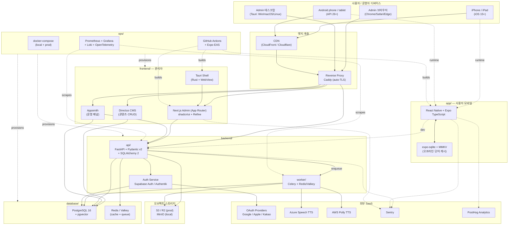
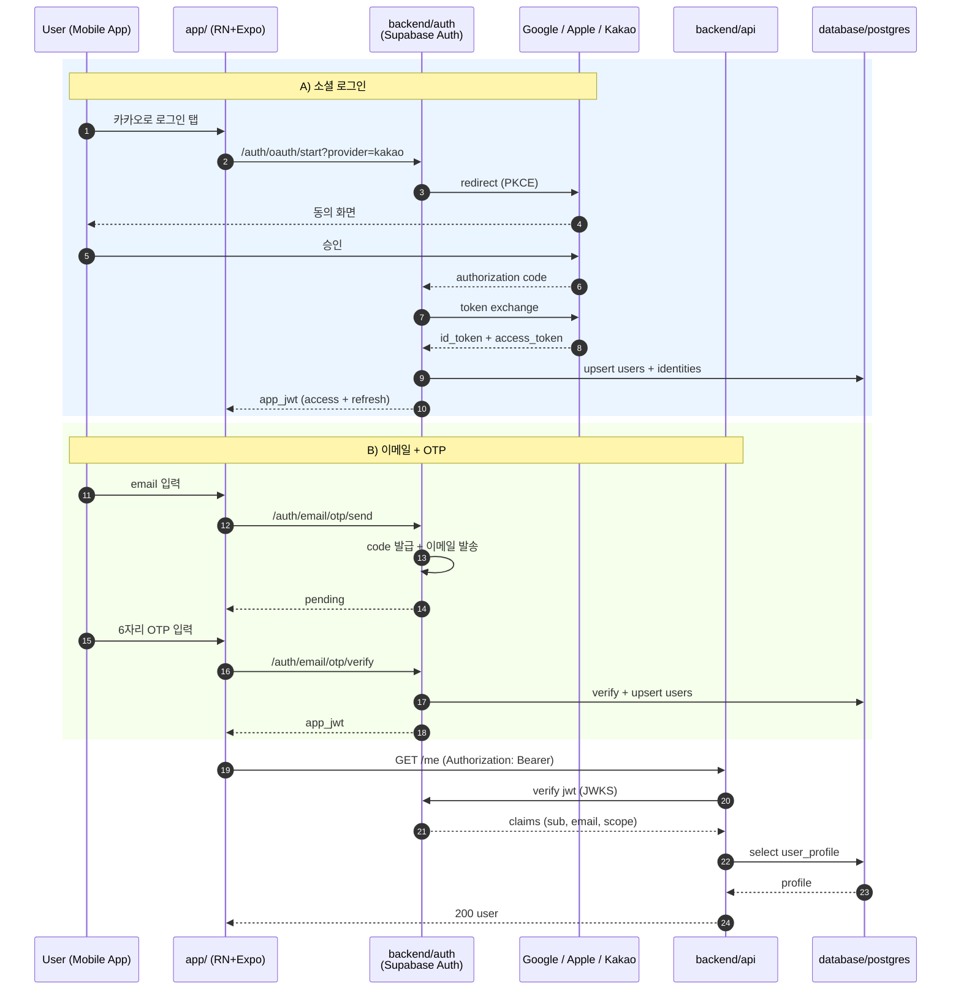
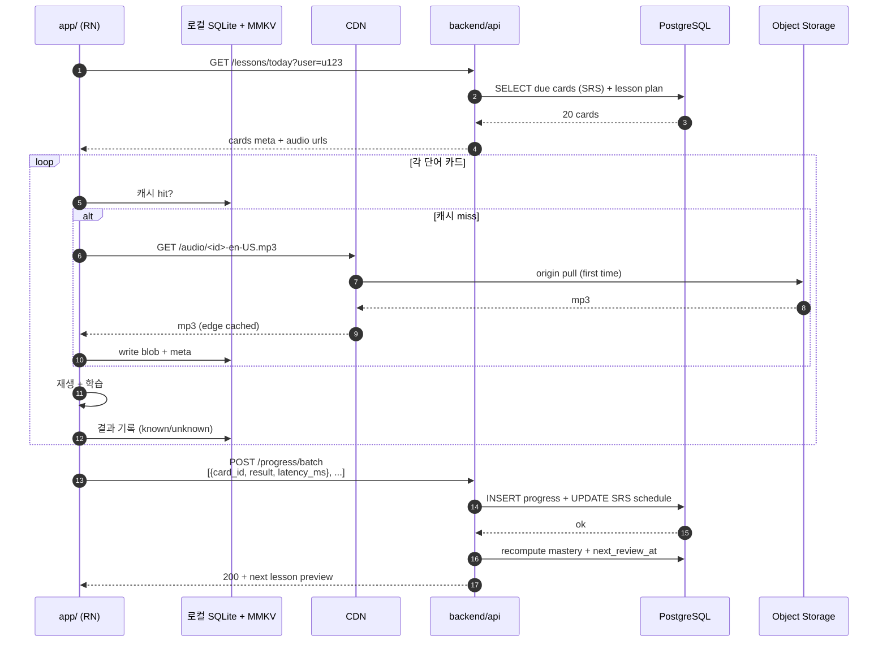
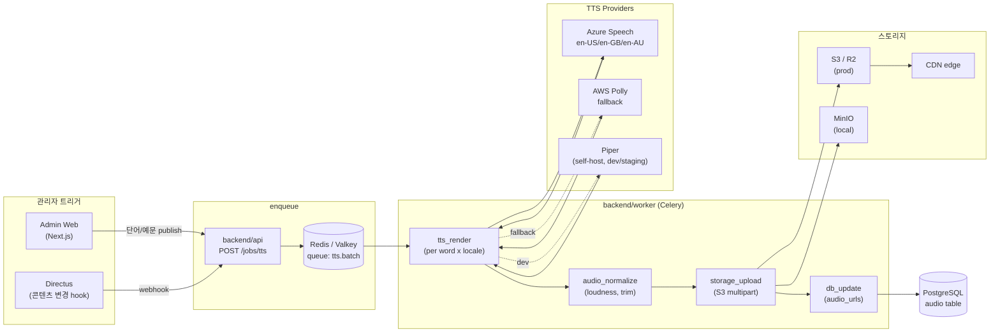
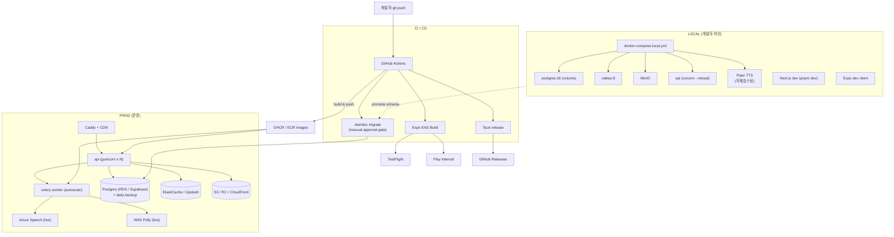
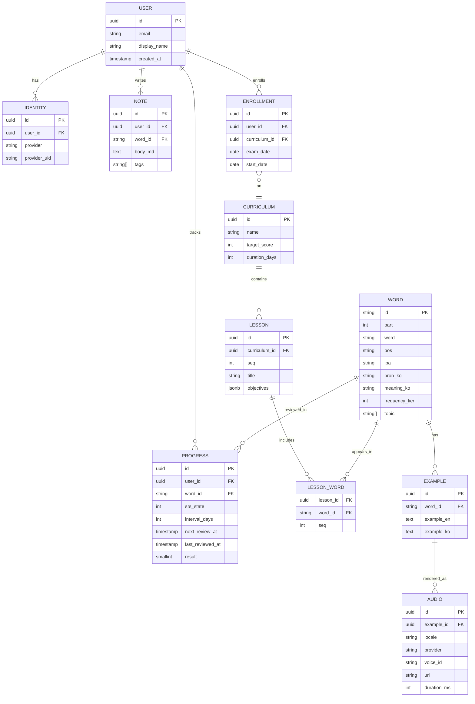
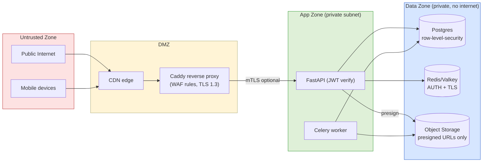

# Vocabulary-NB4-TOEIC Architecture

상세 아키텍처 도면. 5개 컴포넌트 (app / frontend / backend / database / ops) + 외부 시스템 (OAuth, TTS, CDN, Monitoring).

---

## 1. 전체 시스템 개요 (Component Topology)

---

## 2. 인증 플로우 (OAuth + Email OTP)

---

## 3. 학습 데이터 흐름 (단어 카드 학습 + 진도 저장)

---

## 4. TTS 배치 파이프라인 (예문 다국적 음원 생성)

---

## 5. 환경 분리 (local vs prod) + 배포 토폴로지

---

## 6. 컴포넌트 책임 매트릭스 (RACI 요약)

| 책임 | app | frontend | backend/api | backend/worker | database | ops |
|---|---|---|---|---|---|---|
| 사용자 인증 토큰 보관 | **R** | — | A | — | C | C |
| 학습 카드 렌더링/재생 | **R** | — | C | — | C | — |
| 콘텐츠 CRUD | — | **R** | A | — | C | — |
| TTS 음원 생성 | — | T (트리거) | A | **R** | C | I |
| 진도/SRS 계산 | C | C | **R** | C | C | — |
| 스키마 마이그레이션 | — | — | C | — | C | **R** |
| 빌드/배포 | — | C | C | C | C | **R** |
| 모니터링/알림 | I | I | I | I | I | **R** |

R = Responsible, A = Accountable, C = Consulted, I = Informed, T = Trigger.

---

## 7. 데이터 모델 핵심 엔터티 (논리)

---

## 8. 보안 경계 (Trust Boundaries)

보안 원칙:
- JWT 검증 후에만 데이터존 접근.
- Object Storage 직접 URL 노출 금지 — presigned URL 5분 만료.
- Postgres RLS로 `user_id = auth.uid()` 강제.
- Secrets: ops/env (gitignore) + GitHub Actions Secret + AWS Secrets Manager (prod).
- 비밀번호: Argon2id, OTP: TOTP/HMAC + 1회용.

---

끝.
